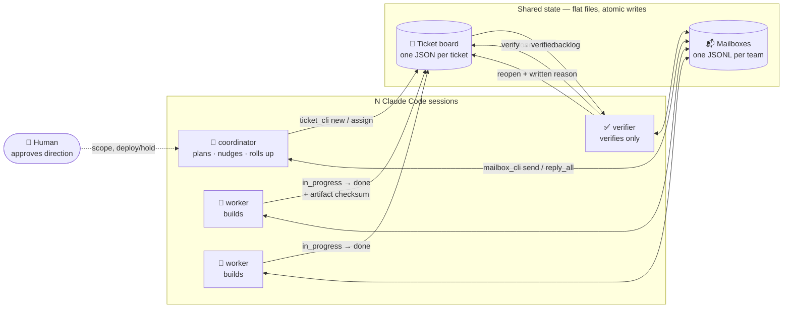
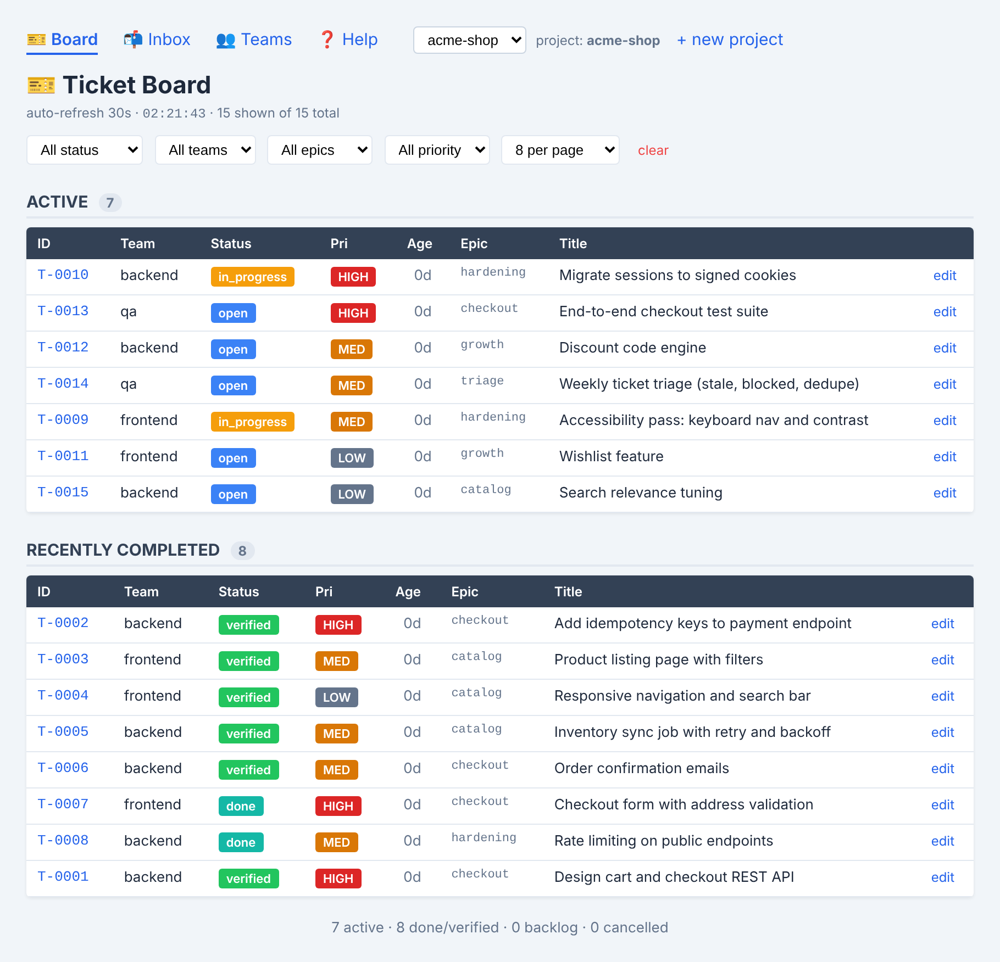

<div align="center">

# 🎫 Aira

**Turn parallel AI agent sessions into a self-running team — coordinated by a ticket board and JSONL mailboxes.**

[]()
[]()
[]()
[]()
[](https://github.com/shahabeddin/aira/actions/workflows/ci.yml)
[](LICENSE)
[](https://github.com/shahabeddin/aira)

*Zero-dependency. Agent-native. Git-friendly.*

</div>

---

> 🧩 A lightweight coordination substrate for teams of Claude Code (or any shell-capable AI) sessions: a **ticket system** with an enforced-but-optional verification workflow, and an **inter-team mailbox** for asynchronous agent-to-agent messaging. Plain Python 3 (stdlib only) + JSON/JSONL files — no database, no server required, diffable and committable by construction.
>
> A **team** is a named member of the roster — a worker, the coordinator, or the verifier — typically one Claude Code session.

## 🚀 Quick start

Either:

**A. Clone the repo, then run `setup.md`** (installs the existing repo + onboards a project) —
```sh
git clone https://github.com/shahabeddin/aira.git && cd aira
```
Then in a Claude Code session there: `Read setup.md and run it.`

**B. Or, build from scratch — no clone needed.** Open a fresh Claude Code session in your desired
directory and paste one line:
```
Read https://raw.githubusercontent.com/shahabeddin/aira/main/BUILD_PROMPT.md and execute it fully.
```

Either way you end up with the board running and a join card: `setup.md` clones the repo (or uses
your local copy), installs the 7 slash commands + fetches `/grill-me`, sets `AGENT_TEAM_TOOLS`, and
runs `/team-up`; `BUILD_PROMPT.md` reconstructs the whole system from nothing, then does the same
onboarding. In both, the session becomes the **supervisor**, grills your brief, creates a project
+ working directory, proposes a team roster, starts the board server, and prints the join commands.

Already onboarded? Resume your team's session:
```sh
export CLAUDE_TEAM=<team> && claude --resume
```
Name sessions `<project> - <team>` so they're easy to spot; then `/check-inbox` for mail, `/ticket`
to work the board. Done? `./uninstall.sh` removes just the Claude Code integration (slash commands
+ `AGENT_TEAM_TOOLS`) — your repo, projects, and data stay put.

## ✨ Features

- 🧱 **Clean by construction** — work is carved into lanes (clean ownership boundaries: frontend/backend, data/modeling), one worker per lane owning a deep module behind a narrow interface, after Ousterhout's [*A Philosophy of Software Design*](https://www.goodreads.com/book/show/58665335) & Evans' [*Domain-Driven Design*](https://www.goodreads.com/book/show/179133-domain-driven-design). Guidance, not dogma — the coordinator can skip lanes for solo/small work. See [`docs/lanes-and-modules.md`](docs/lanes-and-modules.md).
- 🎫 **Ticket board** — one JSON per ticket; enforced workflow `backlog → open → in_progress → (blocked) → done → verified`; color-coded, sortable/filterable/paginated web UI.
- 📬 **Inter-team mailbox** — async messaging between teams (JSONL inboxes, reply-all threading, atomic appends, per-team `flock` so concurrent sends never clobber).
- ✅ **Optional verify gate** — a declared verifier is the only one that may mark work `verified`; declare none and the gate is off (solo/marketing). Separation of powers.
- 🗂️ **Multi-project support** — isolated stores under `projects/<name>/`; create as many as you want, nothing shared between them.

Plus: teams as data (on-disk manifests with roles) · `/team-up` onboarding (one slash command proposes a roster) · project-scoped web UI (board, inboxes, team manager, help) · flat files & atomic writes (temp+rename, `flock`) · two stdlib CLIs, 0 dependencies · pre-registration as governance (testable AC locked before work) · per-ticket compaction (one subagent per ticket; context discarded on return).

## 🧭 How it works

**The org chart is N Claude sessions.** Each session is a "team" with a role; the board is shared state, the mailboxes are async messaging, and a human approves direction while agents execute everything else.



*The verifier is the only team that may set `verified` — and it never builds. Declare no verifier and that gate is simply off.*

**Workflow law:** `backlog → open → in_progress → (blocked) → done → verified`.
- `done` = builder finished, **awaiting verification**.
- `verified` = terminal success — only the declared verifier may set it.
- A failed verify **reopens with a written reason** naming the unmet acceptance criteria.

**Team identity** resolves as: `--by` flag → `CLAUDE_TEAM` env → `<cwd>/.current_team` → global → `unknown`. Parallel sessions set `CLAUDE_TEAM` at launch; a solo session can use `/set-team` mid-flight.

**Lanes & deep modules (guidance, not law).** A lane is a clean ownership boundary along a real domain axis — frontend / backend, data / modeling. One worker owns one lane and the *deep module* behind it: rich behavior behind a narrow interface to the other lanes, not a shallow pass-through. The coordinator decides whether a project uses lanes at all — solo and small projects use none. The inter-lane interface is a contract, verified by the ticket's acceptance criteria at the seam. `/team-up` proposes the lanes; each lane's module interface is recorded in its team `--description` (shown on the `/teams` page). Full reference: [`docs/lanes-and-modules.md`](docs/lanes-and-modules.md).

**Context cadence.** Each team compacts its own context every 1–2 tickets — persisting state to the tickets (comments + artifact checksums) and inbox *first*, then compacting, and re-reading the board as authoritative on wake. Persist-before-compact keeps long projects affordable and compaction non-destructive.

## ⌨️ Slash commands

| Command | What it does |
|---|---|
| `/team-up` | Spin up or connect to a project; propose a roster; start the board |
| `/set-team <team>` | Set this session's team identity (used as `--by` by the CLIs) |
| `/check-inbox` | Read and handle unread mail; reply-all to the audience |
| `/ticket [id]` | Work a ticket: pick up, do via a subagent, close with a checksum — no ID, and it picks one from the board |
| `/team-send <recipients\|all> <message>` | Send a message (each recipient sees the full to-list) |
| `/lead` | Coordinator pass: nudge stalled teams, roll up a status summary for the human |

> **External skill — `/grill-me`**: installed by `setup.md` from [`external-skills.txt`](external-skills.txt) (content fetched, not vendored, pinned to a reviewed upstream commit; it pulls in the companion `grilling` skill). It interviews a loose idea until it's a committed plan — handy for the coordinator to stress-test a brief *before* turning it into tickets. Add more external skills the same way (one line in the manifest).

## 📁 Project layout

```
aira/
  tickets/        ticket_cli.py · board_server.py · README.md
  teams_mailbox/  mailbox_cli.py · README.md
  templates/      CLAUDE_TEAM.md · SKILL_*.md · README_GOVERNANCE.md
  .claude/commands/   the 7 slash commands (team-up, set-team, check-inbox, ticket, lead, team-send, present)
  projects/
    <name>/
      project.json    workdir manifest (where the team actually works)
      teams/         <team>.json manifests (role: verifier|coordinator|worker)
      tickets/        T-XXXX.json · INDEX.md · archive/YYYY-MM/
      teams_mailbox/  <team>/inbox.jsonl
  setup.md         install entry point (URL or local path → clone/use + onboard)
  uninstall.sh     inverse of setup.md (removes the Claude Code integration only)
  docs/            lanes-and-modules.md · ml-problem-checklist.md · running-teams.md
  BUILD_PROMPT.md  canonical from-scratch build spec
```

## 🔧 Configuration (env vars)

| Env var | Purpose |
|---|---|
| `CLAUDE_TEAM` | this session's team (default for `--by`) |
| `AGENT_TEAM_PROJECT` | the active project; scopes every ticket/mailbox call |
| `AGENT_TEAM_TOOLS` | path to this repo; lets skills find the CLIs from any directory |
| `AGENT_TEAM_TICKETS` | override the ticket data dir |
| `AGENT_TEAM_MAILBOX` | override the mailbox data dir |
| `AGENT_TEAM_PROJECTS_ROOT` | root for `projects/` (default `<repo>/projects`) |

## 📚 Docs

- [`BUILD_PROMPT.md`](BUILD_PROMPT.md) — the canonical, from-scratch build spec (keep in sync with code).
- [`setup.md`](setup.md) · [`uninstall.sh`](uninstall.sh) — the one-line install entry point, and its inverse (removes just the Claude Code integration).
- [`docs/lanes-and-modules.md`](docs/lanes-and-modules.md) — how to carve a project into lanes + deep modules (guidance, not law).
- [`docs/ml-problem-checklist.md`](docs/ml-problem-checklist.md) — the lens `/grill-me` and the coordinator should use for ML problems (data/labeling, requirements, model selection, OOD eval, notebooks).
- [`docs/running-teams.md`](docs/running-teams.md) — operating craft for running agent teams (watchers, long-running jobs, ticket hygiene, docs discipline).
- [`templates/README_GOVERNANCE.md`](templates/README_GOVERNANCE.md) — the operating rules (verification as separation of powers, pre-registration, lane discipline, context compaction, escalation).
- [`CONTRIBUTING.md`](CONTRIBUTING.md) — dev setup, tests, and guidelines.
- [`tickets/README.md`](tickets/README.md) · [`teams_mailbox/README.md`](teams_mailbox/README.md) — per-tool hygiene and workflow.

## 🖥️ Web UI

A live board, mailbox threads, and a verify gate — all from flat files:

<p align="center">
  
</p>

The web UI (`http://127.0.0.1:8889`) renders the board, inboxes, a team manager, and a help page — project-switchable in the nav.

<div align="center">

---

*Humans approve direction. Agents execute everything else.*

</div>
